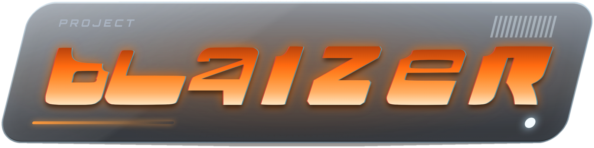

<p align="center">
  
</p>

<p align="center">
  A reimplementation of <b>Motorhead</b> (Digital Illusions, 1998) for Linux and Windows 11.<br>
  It plays from a copy of the game that you own. <b>This repository contains no game data.</b>
</p>

<p align="center">
  <a href="../../releases/latest"><b>Download the latest release</b></a> ·
  <a href="CHANGELOG.md">Changelog</a> ·
  <a href="#building-from-source">Build from source</a>
</p>

- **Classic** mode follows the original's rendering. **Remaster** mode (F9 in the game) is a modern
  renderer over the same tracks, cars and physics.
- All 8 tracks and 10 cars, single races, leagues, time attack, ghosts and replays, rankings,
  keyboard, gamepad and wheel input.
- No installation of Rust is needed to play: ready-made programs are on the
  [Releases page](../../releases/latest).

## What you need

- Your own copy of **Motorhead** (the CD, a disc image of it, or an existing install). The game's
  data is not distributed here and never will be.
- Linux or Windows 11, 64-bit (x86_64).
- A graphics card with Vulkan (Linux, Windows), DirectX 12 (Windows) or OpenGL (Linux) drivers.

## Quick start

You have Motorhead installed already: the game folder is the one that holds `motor.exe`.

1. Download `motorhead-<tag>-linux-x86_64.tar.gz` or `motorhead-<tag>-windows-x86_64.zip` from the
   [Releases page](../../releases/latest) and unpack it.
2. Copy **`motorhead`** (`motorhead.exe` on Windows) into the game folder, next to `motor.exe`.
3. Start it there. Or start it from anywhere with the folder as its argument:
   `motorhead /path/to/game/folder`.
4. Download `motorhead-remaster-<tag>.zip`, unzip it over the
   game folder so `remaster` folder is in same folder as `motorhead`/`motorhead.exe` ([details](#remaster-pack)).
5. Launch the game, by default it starts in classic/vanilla mode, press `F9` to switch to remaster mode

**No installed game yet?** Optional first step: run **`motorinstall`** from the same package (the
Windows zip and the Linux archive both contain it), pick your own CD image and an empty folder, and
press Install. That folder is your game folder for the steps above
([details](#install-the-game-data)).

## Download

Every release on the [Releases page](../../releases/latest) has these files (`<tag>` is the version,
for example `v0.9.1-alpha`):

| File | What it is | Who needs it |
|---|---|---|
| `motorhead-<tag>-linux-x86_64.tar.gz` | `motorhead` (the game) and `motorinstall` (the installer) for Linux | Linux players |
| `motorhead-<tag>-windows-x86_64.zip` | The same two programs for Windows 11 (`.exe`) | Windows players |
| `motorinstall-<tag>-linux-x86_64.tar.gz`, `motorinstall-<tag>-windows-x86_64.exe` | The installer on its own (the same program as in the packages above) | Anyone who only wants the installer |
| `motorhead-remaster-<tag>.zip` (+ `.sha256`) | The optional **Remaster pack**, about 180 MB | Anyone who wants the full Remaster look |
| `SHA256SUMS` | Checksums of the program files | Optional check |

None of them contains game data. You still need your own copy of Motorhead.

**Check a download** (optional). Put `SHA256SUMS` next to the files and run:

```sh
sha256sum --ignore-missing -c SHA256SUMS                      # Linux
```
```powershell
Get-FileHash .\motorhead-<tag>-windows-x86_64.zip -Algorithm SHA256   # Windows: compare with SHA256SUMS
```

On Linux, unpack with `tar -xzf motorhead-<tag>-linux-x86_64.tar.gz`; the executable bit is kept.

## Install the game data

`motorinstall` builds the game folder from your own disc image. It unpacks the original
InstallShield cabinet, copies the movies and rips the CD music to FLAC (`Music/`).

- **With a window:** start `motorinstall` with no arguments, pick the image and the target folder,
  press Install. It checks that the image is the Motorhead CD, asks before writing into a folder that
  is not empty, shows progress and, when done, the command that starts the game.
- **In a terminal:**

  ```sh
  motorinstall motorhead.cue ~/games/motorhead     # .cue/.bin: game data + CD music
  motorinstall motorhead.iso ~/games/motorhead     # .iso: game data only, no music
  ```

The source can be a `.cue` sheet (its `.bin` beside it), an `.iso`, a raw `.bin` or `.img`, or a
folder (a mounted disc or a copied CD). `--no-music` skips the music. An `.iso` has no CD audio, so
the game then runs without music.

If you already have a Motorhead install, you can skip this step and use that folder.

## Run the game

Put `motorhead` (`motorhead.exe` on Windows) **next to `motor.exe`** in the game folder and start it
there. Without an argument it uses the folder it sits in, or the working folder when that holds
`motor.exe`. You can also give the folder explicitly, and an explicit folder always wins:

```sh
./motorhead ~/games/motorhead          # Linux
.\motorhead.exe D:\Games\Motorhead     # Windows
```

`motorhead --version` prints the version.

**Default controls** (all of them can be changed in Options > Controls):

| Key | Action | Gamepad |
|---|---|---|
| Arrow keys | Steer, accelerate, brake | Left stick, right / left trigger |
| S / A | Gear up / down | Right / left bumper |
| Space | Horn | Left stick click |
| Shift | Hand brake | X |
| Ctrl | Look back | Y |
| R | Put the car back on the track | Select |
| V, F1, F2, F3 | Change camera | B, D-pad |
| Tab | Race information | Right stick click |
| Esc | Pause menu | Start |
| F9 | Switch Classic and Remaster | |
| F12 | Screenshot | |

Settings are saved in `~/.config/motorhead/settings.cfg` (Windows: `%APPDATA%\Motorhead\settings.cfg`).

## Remaster pack

Remaster mode works without it, with plainer defaults (the original's sky band, no generated scenery
around the tracks, the stock rims). The pack (`motorhead-remaster-<tag>.zip`) adds the data for the
full look: per-track fog, world fill, custom rims, HDRI skies, track pictures and the simulated
engine sound.

1. Download `motorhead-remaster-<tag>.zip` (and the `.sha256` file to check it).
2. Unzip it **over the game folder** (the one with `motor.exe`). It adds one folder, `remaster/`.
3. Start the game and press **F9**.

Classic mode never reads this folder, so it looks the same with or without it.

After unzipping, the game folder looks like this (the original's own files and folders are only
partly listed):

```text
Motorhead/                    <- the game folder: the one that holds motor.exe
├── motor.exe                 <- from the original game
├── motorhead.exe                 <- this program (motorhead on Linux)
├── Game/  Data/  Cars/  Tracks/  Sounds/  League/  movies/  Music/   <- the original's folders
└── remaster/                 <- added by the Remaster pack
    ├── README.txt
    ├── engines/              <- baked engine loops (simulated engine sound)
    ├── fill/                 <- generated scenery around the tracks (trackNN.fill)
    ├── fog/                  <- per-track fog (trackNN.fog)
    ├── rims/                 <- custom rims (carNN.rim)
    ├── sky/                  <- one HDRI sky per track (trackNN.exr)
    └── ui/previews/          <- track pictures for the Remaster menus
```

If `remaster/` ended up one level deeper (`Motorhead/motorhead-remaster-<tag>/remaster/`), move it up
so that it sits directly beside `Game/` and `motor.exe`.

## Classic and Remaster

**Classic** follows the original's pipeline: the same textures, lighting, fog and cameras as the
1998 game, so a race looks like it did then. **Remaster** (F9, or Options > Graphics) draws the same
scene with a modern renderer: anti-aliasing, bloom, shadows, water, grass, a rebuilt HUD and menus,
and generated car bodies. Switching never reloads the race. The Graphics options choose each detail.

## Troubleshooting

- **No music.** The installer was given an `.iso` (no CD audio). Use the `.cue`/`.bin` pair, or copy
  your own tracks into the game's `Music/` folder.
- **"no game found here".** `motorhead` is not next to `motor.exe` and no folder was given. Copy it
  there or pass the folder as the argument.
- **Windows warns about an unknown program.** The programs are not code-signed. Check the download
  against `SHA256SUMS` and choose "Run anyway" if it matches.
- **Linux: the program does not start.** It needs the system's ALSA (`libasound2`) and udev
  (`libudev1`) libraries, which most desktops already have.
- **Black screen or a graphics error.** Update the graphics driver. Without a working Vulkan, DirectX 12
  or OpenGL driver the game cannot draw. On Windows you can also
  [force one graphics backend](#graphics-backend-windows).

### Graphics backend (Windows)

The game picks the graphics API automatically (DirectX 12 or Vulkan on Windows). If it fails to
start, shows a black window or crashes, force one backend with the `WGPU_BACKEND` environment
variable: `dx12` or `vulkan`.

**Laptops with Intel integrated graphics:** on one such laptop the automatic choice failed and
forcing **DX12** fixed it, so try `dx12` first there. If your driver is old, update it as well.

**PowerShell**:

```powershell
setx WGPU_BACKEND dx12      # or: setx WGPU_BACKEND vulkan
```

**Back to automatic selection:**

```powershell
reg delete HKCU\Environment /v WGPU_BACKEND /f
```

## Building from source

You only need this to change the code or to build for another system.

Rust 1.95 or newer. On Linux install the ALSA and udev development packages (`libasound2-dev`,
`libudev-dev` on Debian and Ubuntu).

```sh
cargo build --release
cargo run --release --bin motorhead -- ~/games/motorhead
cargo test --release --workspace
```

The programs are in `target/release/` (`motorhead`, `motorinstall`, `motorview`). The version lives
in one place, `version` in the root `Cargo.toml`.

**Windows `.exe` from Linux** (needs a MinGW linker, for example `sudo pacman -S mingw-w64-gcc`):

```sh
rustup target add x86_64-pc-windows-gnu
cargo build --release --target x86_64-pc-windows-gnu
```

**On Windows 11:** install Rust with rustup and run `cargo build --release`.

### Other programs

```sh
cargo run --release -p motorview --bin motorview -- ~/games/motorhead --track 1 --car 1   # developer viewer
cargo run --release -p motor-sim --bin motorrace -- ~/games/motorhead --track 1            # headless AI race
```

A headless screenshot of any game screen: `motorhead ~/games/motorhead --shot SCREEN out.png [--remaster]`.

### The crates

- `motor-data`: loaders for the original file formats
- `motor-sim`: car physics, race rules and the AI
- `motor-audio`: the sound mixer
- `motorview`: the renderer and the game (`motorhead`), and a developer viewer (`motorview`)
- `motorinstall`: installs the game from your disc image

## About this repository

This repository is generated from the author's development repository, one commit per release. Each
release is tagged `vX.Y.Z`; pushing the tag builds the Linux and Windows packages and attaches them
to the Release.

## Credits

- Skies of the Remaster pack: HDRIs from [Poly Haven](https://polyhaven.com/hdris), CC0 1.0.
- Engine loops of the Remaster pack: rendered with
  [engine-sim](https://github.com/ange-yaghi/engine-sim) by AngeTheGreat (Ange Yaghi), MIT licence.
- Motorhead is a game by Digital Illusions (1998). This project is not affiliated with its makers.

## Licence

Copyright (C) 2026 Motorhead reimplementation contributors.

This program is free software: you can redistribute it and/or modify it under the terms of the
GNU Affero General Public License as published by the Free Software Foundation, either version 3
of the License, or (at your option) any later version (see `LICENSE`). Bundled assets keep their
own licences (see the `LICENSE` files under `assets/`). The licence covers this code only, not the
original game or its data, which stay the property of their owners.
